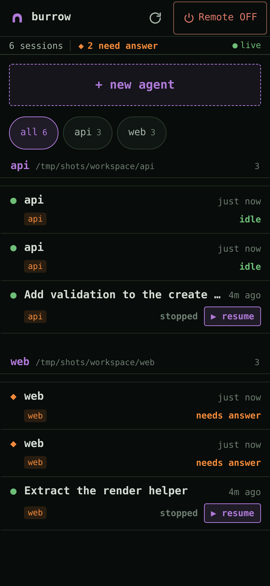
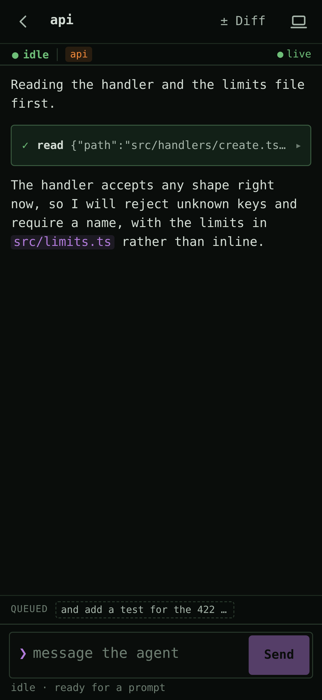
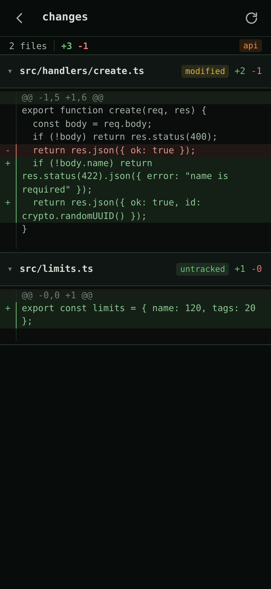

# Burrow

[](https://github.com/Erion14/burrow/actions/workflows/ci.yml)
[](LICENSE)
[](https://bun.sh)

Burrow is a phone remote for [omp](https://github.com/can1357/oh-my-pi) coding
agents. From the phone it lets you prompt an agent that runs on the host, answer
its questions, watch the transcript and review the diff, while the host stays
home on the charger. It is not a terminal: Termux, mosh and herdr remain the
answer for real terminal work.

Reachable only over Tailscale, and only while Remote mode is on.

```
phone (PWA) --HTTPS/WSS over tailnet--> tailscale serve
                                          |-- /     -> burrow     127.0.0.1:7470  (Remote ON)
                                          '-- /wake -> burrow-wake 127.0.0.1:7471  (always on)
```

## Screens

| Sessions | Chat | Dialog | Diff |
| --- | --- | --- | --- |
|  |  |  |  |

Captured from the phone viewport against a scratch repo and the scripted omp in
`test/fake-omp.ts`, so the data is made up.

## What it does

- **Sessions.** One `omp --mode rpc-ui` process per session, started in an
  allowlisted repo. Running sessions and recent session files, grouped by
  workspace, with a status dot: working, needs your answer, idle, stopped.
- **Chat.** Streaming text, thinking, collapsed tool cards, subagent progress,
  queued messages, and dialogs rendered for every kind omp asks: `select`,
  `confirm`, `input`, `editor` and `ask` (buttons, plus free text where omp
  allows it).
- **Diff.** Read only `git diff HEAD` plus untracked files per repo. A directory
  holding several git repos diffs each one below it, so a workspace like `~/code`
  works. Bounded so a large untracked tree cannot stall it.
- **Handoff.** "Hand off" stops Burrow's process, then `omp -r <id>`
  continues the same conversation. A session open at the host cannot be
  resumed from the phone: one writer per session file, checked through `/proc`.
- **Alerts.** Two pushes only, "finished" and "needs your answer", through ntfy,
  with a tap that opens that session. Bodies never contain transcript text.
- **Remote mode.** `remote.sh on` takes a sleep inhibitor and starts the server;
  off stops both. `burrow-wake` and the `tailscale serve` config stay up, so the
  phone can always turn Remote back on. On the charger the host stays awake
  with the lid closed, and the GDM login screen no longer suspends on AC.

## Requirements

- [Bun](https://bun.sh) 1.4 or newer, on the host.
- [omp](https://github.com/can1357/oh-my-pi) on `PATH`, with its config in place.
- [Tailscale](https://tailscale.com) on both devices, same tailnet, with the
  host's tailscale operator set to your own user (so `tailscale serve` needs
  no sudo).
- Chrome on the phone, for "Install app".

## Install

On a machine that is not the author's, start with [SETUP.md](SETUP.md): it
holds a prompt to hand to your own coding agent, which inspects the machine,
asks for the allowlist and the sudo steps, adapts the host parts, and verifies
the wake path at the end. The manual steps are below.

```bash
git clone https://github.com/Erion14/burrow && cd burrow
bun install
bun run build
host/install.sh            # units, scripts, tailscale serve config; prints the sudo lines
```

Then, on the phone:

1. Open `https://<host>.<tailnet>.ts.net/` in Chrome and use **Install app**.
   Burrow has to be running for that first load; after it, the shell is cached
   and Turn ON works while Remote is off.
2. Turn Remote on, start an agent in one of your repos, and send it a prompt.

`host/` is written for a Fedora machine running Hyprland with systemd user
services and linger enabled. On another setup, read `host/README.md` and take
the parts that apply.

## Configuration

| File | Purpose |
| --- | --- |
| `~/.config/burrow/repos` | Allowlist, one absolute path per line. Agents only start in these. |
| `~/.config/burrow/ntfy` | One line: the ntfy topic URL for alerts. Missing means no alerts. |

Environment overrides: `BURROW_PORT`, `BURROW_WAKE_PORT`, `BURROW_OWNER_LOGIN`,
`BURROW_ORIGIN`, `BURROW_CONFIG_DIR`, `BURROW_REPOS_FILE`, `BURROW_NTFY_FILE`,
`BURROW_OMP_COMMAND`, `BURROW_SESSIONS_DIR`, `BURROW_IDLE_TIMEOUT_MS`,
`BURROW_WEB_ROOT`, `BURROW_REMOTE_SH`.

## Access rules

Every request must carry a `Tailscale-User-Login` header equal to the host's
own tailnet login, and every state-changing request and WebSocket upgrade must
also carry the Burrow `Origin`. A page in the host's browser can reach loopback
directly, which is why the origin check is there, and why a foreign header never
reaches omp.

## Development

```bash
bun test        # fake omp over stdio, real HTTP, WebSocket, git and session files
bun run build   # bundles the PWA into dist/web
bun run start   # the server on 127.0.0.1:7470
```

No test calls a model. `test/fake-omp.ts` speaks omp's RPC protocol over stdio
and is the only faked port. [AGENTS.md](AGENTS.md) is what an agent working on
Burrow needs to know; [SETUP.md](SETUP.md) is what an agent installing it needs.

## Security

See [SECURITY.md](SECURITY.md). Short version: loopback only, tailnet identity,
origin checks, allowlist, one writer per session file.

## License

MIT. See [LICENSE](LICENSE).
